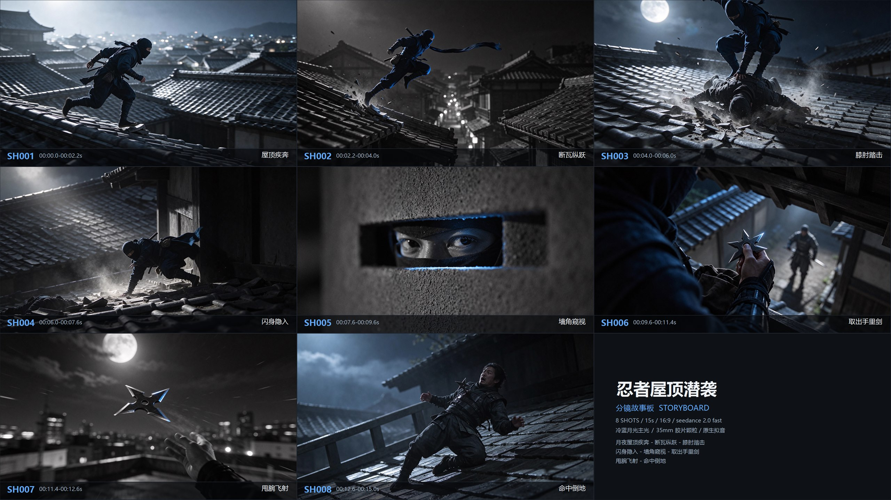

# storyboard-sheet

把任意故事、脚本、短剧段落拆成镜头单，逐格生成统一风格的分镜画面，自动拼成带镜头号与时长标注的故事板（多格拼板图）的 Agent 技能。

设计目标：**高质量、高衔接、高溯源、高可用、不穿帮、站位一致、场景一致**。

## 示例成品



*示例：8 镜 + 标题卡，3×3 网格拼成 3840×2160，此处为长边 2560 的 JPG 预览。冷蓝月光点缀、35mm 胶片颗粒、写实电影质感；全片 15s、16:9。*

| 镜头 | 时长 | 镜头名 | 画面要点 |
|---|---|---|---|
| SH001 | 00:00.0–00:02.2s | 屋顶疾奔 | 月夜瓦屋顶上低姿疾奔，远景城市灯火 |
| SH002 | 00:02.2–00:04.0s | 断瓦纵跃 | 蹬碎瓦当高高跃起，碎屑飞扬 |
| SH003 | 00:04.0–00:06.0s | 膝肘踏击 | 膝肘同时砸落，敌人被压向瓦面 |
| SH004 | 00:06.0–00:07.6s | 闪身隐入 | 贴墙翻身滑入屋角阴影，尘土扬起 |
| SH005 | 00:07.6–00:09.6s | 墙角窥视 | 墙缝特写，只露双眼，冷蓝边缘光 |
| SH006 | 00:09.6–00:11.4s | 取出手里剑 | 手部近景捏住手里剑，远处敌人虚焦 |
| SH007 | 00:11.4–00:12.6s | 甩腕飞射 | 手里剑旋转掠过夜空，月亮在左上 |
| SH008 | 00:12.6–00:15.0s | 命中倒地 | 敌人仰面倒向瓦面，动作定格瞬间 |

标题卡信息：片名「忍者屋顶潜袭」＋ `8 SHOTS / 15s / 16:9 / seedance 2.0 fast` ＋ 质感说明 ＋ 三条内容提要。

这张板的镜头单文件是 [assets/shots.example.json](assets/shots.example.json)，含 `anchors`／`cameras`／逐格 `in_state`／`out_state`／`prompt`／`ref`／`qa` 溯源字段，可直接 `validate-shots.ps1` 校验后复现。

## 核心思路

稳定的关键不是临场发挥，而是固定链路：

```
内容卡 → 镜头单 → 静态校验 → 逐格生成 → 逐格质检 → 溯源回写 → 拼板叠字 → 整板终审交付
```

**第一验收标准是衔接，不是风格。** 故事板只作参考，风格可以随手定，但格与格必须真有推进：每格写四量表 `delta`（接触点／位移／相位／可视结果），`change` 必须落进 `out_state`；相邻格 `delta` 四项全同判 FAIL，景别连跳两级判 FAIL，相邻动作段相似度 > 0.5 判 FAIL。这三条量化出来的就是观众嘴里的“接不上”。

## 两种出图模式（先看成本）

| 模式 | `board_mode` | 生图调用 | 每格分辨率 | 用在 |
|---|---|---|---|---|
| 逐格生成再拼板 | `panel`（默认） | **N 次**（N=格数） | 单帧 1536×864 | 定稿、单帧交付、给视频做首帧、要逐格重出 |
| 单次整板 | `single` | **1 次** | 整板一次出图，每格约逐格的 1/3–1/2 | 快速过方案、只看结构与节奏、成本敏感 |

`single` 模式只多两个顶层字段：`board_mode: "single"` 与 `board_prompt`（整板整段 Prompt 原句，每格一行、必须写出该格比上一格多了什么）。生成后不用拼图，直接 `annotate-board.ps1` 把镜头号／时长／镜头名叠到每格底部。衔接优先规则在两种模式下都照跑，只是 `single` 把“逐格核对”换成“整板一次核对”。

**风格是可选装饰项**：开板最多问一次——原装写实（默认兜底）／黑白线稿／黑白灰阶素描／日式漫画网点／2D 赛璐璐／国漫 3D／3A 游戏 CG／水彩淡彩。不选不影响开工，`style_preset` 缺失只报 WARN，风格只决定质感句、色板、阴影方式与负向补充四件套。

三道门卡死质量：

1. **校验不过不开图** —— `validate-shots.ps1` 对镜头单做静态校验（字段、逐字接力、衔接四量表、景别台阶、动作相似度、锚点原句包含、机位引用、时间连续性），任何 FAIL 先修 JSON。
2. **单格不过不拼板** —— 每条 Prompt 的锚点句从顶层 `anchors` 块（单一事实源）原句复制；每格出图后过十三条质检清单，不合格原地重出（该出场的角色缺席直接判废）。
3. **原句不回写不交付** —— 每格定稿后把 `prompt` 原句、`seed`、`ref` 参考图链、`qa` 结论回写镜头单，任何人拿 JSON 可逐格复现、定位穿帮责任句。

## 目录结构

```
SKILL.md                      技能入口：执行流程与硬规则
references/
  prompt-templates.md         内容卡、单格 Prompt 模板、质检门、失败清单
  continuity.md               空间蓝图、轴线、机位表、尾态首态接力、参考图链、溯源回写
  output-spec.md              格数比例公式、像素与叠字版式、镜头单 JSON 字段规范
assets/
  demo.jpg                    示例成品：8 镜 + 标题卡的整板预览
  shots.example.json          完整示例（8 格 + 标题卡，含 anchors/cameras/溯源字段）
scripts/
  validate-shots.ps1          镜头单静态校验（开图前与拼板前各跑一次；single 模式校验 board_prompt）
  build-board.ps1             拼板叠字（cover 裁切不变形，输出 PNG + JPG 预览）
  annotate-board.ps1          单次整板叠字（在一整张板上按网格叠镜头号/时长/镜头名）
```

## 用法

两个脚本只依赖 Windows 自带 PowerShell 与 System.Drawing，无需安装任何库。

```powershell
# 1. 开图前：静态校验镜头单（不过不开图）
.\scripts\validate-shots.ps1 -SpecPath .\shots.json

# 2. 逐格生成（由 Agent 按 SKILL.md 流程执行，锚点句原句复制 + 参考图链）

# 3. 拼板前：连帧文件一起校验（缺帧直接失败）
.\scripts\validate-shots.ps1 -SpecPath .\shots.json -PanelsDir .\panels -RequirePanels

# 4. 拼板叠字（逐格模式）
.\scripts\build-board.ps1 -SpecPath .\shots.json -PanelsDir .\panels -OutputPath .\board.png -PreviewPath .\board.jpg

# 4'. 单次整板（board_mode=single）：图已经是一整张，只叠字
.\scripts\annotate-board.ps1 -BoardPath .\board_raw.png -SpecPath .\shots.json -OutputPath .\board.png -PreviewPath .\board.jpg
```

校验输出 `WARN`（不阻塞）与 `FAIL`（阻塞，退出码 1）两级；`WARN` 涵盖 `seed`/`qa` 待回写、`style_preset` 缺失按写实兜底、`delta.contact` 未进 Prompt 等提醒项；`FAIL` 涵盖锚点缺失、接力断裂、衔接四量表不全、景别连跳、动作雷同、侧位翻转、槽位没绑主体。

## 一致性机制速查

| 问题 | 机制 |
|---|---|
| 角色跨格变脸 | `anchors.characters` 原句逐格复制 + 首格定基准 + 参考图链 |
| 站位漂移 | 站位以场景固定物为基准（`anchors.blocking`），禁用"前景/左侧" |
| 相邻格接不上 | `out_state`/`in_state` 逐字接力 + 机位表小步移动 + 校验脚本强制 |
| **换了张图但事件没动（假衔接）** | `delta` 四量表：接触点／位移／相位／可视结果必填，相邻格四项全同 FAIL |
| **一段戏里景别忽远忽近** | 景别台阶 1–8，相邻差 ≥3 判连跳两级 FAIL，中间补过渡景别 |
| **相邻两格动作描述长得一样** | `本镜头` 动作段 2-gram 相似度 > 0.5 FAIL，改接触点/位移量/相位或换机位 |
| **该出场的角色缺席** | 动作句点明“左侧 A 服装、右侧 B 服装、中央相撞”，`cast` 与 `screen_side` 双向锁；缺席判废重出 |
| 左右互换 | 轴线定则（`anchors.axis`），全组机位同侧 |
| 忽大忽小 | 比例锚：场景固定尺寸物换算（`anchors.props`） |
| 灯态穿帮 | 可变状态卡符合真实语义（continuity.md 规范表） |
| 角色一格在左、下一格跑到右 | `screen_side` 侧位表逐格写死，同场次序/换边校验，反打必须标 `reverse_shot` |
| 两个主体的参考搞反 | `ref_binding` 一槽一主体（`identity`/`layout` 分离），Prompt 逐槽写"图片N 仅提供…" |
| 穿模、粘连、多肢 | 正向主体分离句（间隙＋前后遮挡＋独立接触阴影）＋ `negative_parts` 四段负向 |
| 只写"不要穿模"却没效果 | 负向拆 `base`/`anatomy`/`geometry`/`separation` 四段，校验脚本强制每格原句包含 |
| 风格跑偏、一格彩色一格黑白 | 风格可选：`style_preset` 单选一次＋四件套锁死，标题卡跟同一预设；缺失按 realistic 兜底，不拦流程 |
| 分镜多、逐格生成太贵 | `board_mode: "single"` + `board_prompt` 走一次生图，`annotate-board.ps1` 后期叠字 |
| 单次整板跨格变脸/翻面 | “统一人物/统一场景”原句照抄＋每格重复发型服装主色＋写入“不镜像翻面” |
| 无法复现 | `prompt`/`seed`/`ref`/`qa` 逐格回写，JSON 即溯源档案 |
